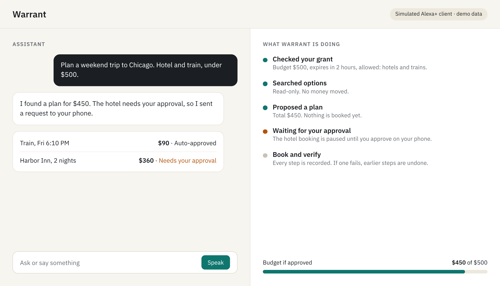
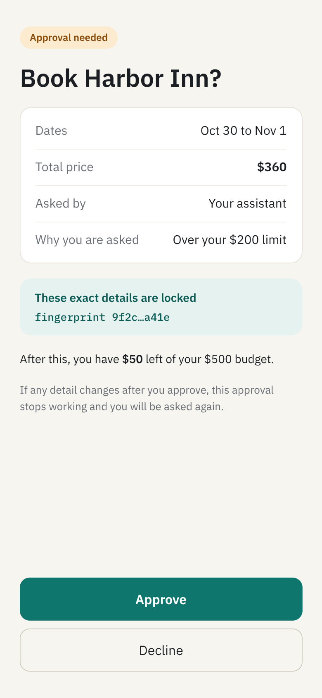
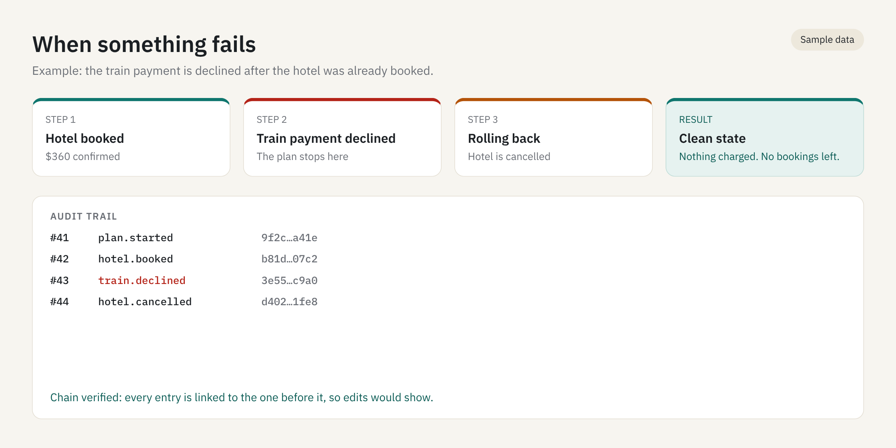
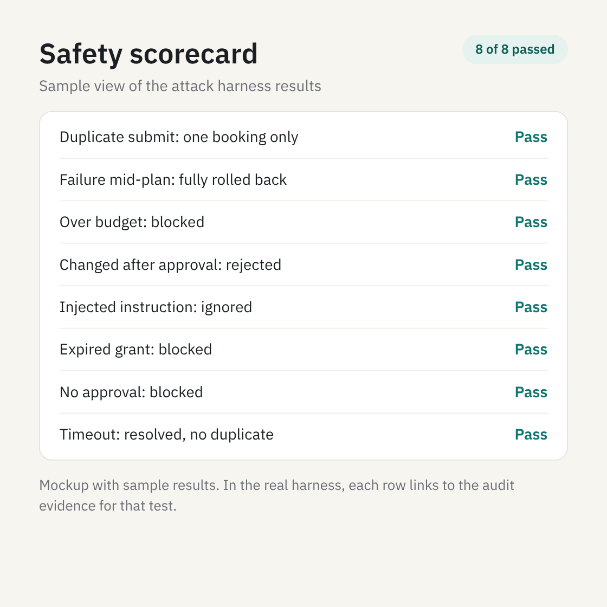
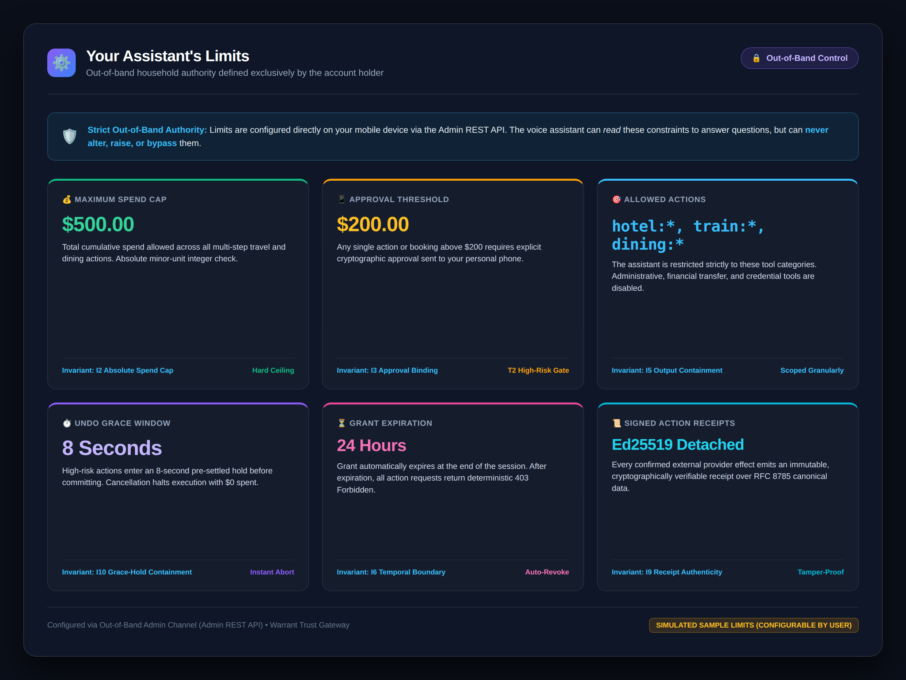

# Warrant: Devpost Submission & Hackathon Strategy

**Hackathon:** Amazon Developer Hackathon (Alexa+ Track)  
**Submission Cutoff:** 23 October 2026, 11:59 PM IST (Official deadline: 24 Oct, 12:30 AM IST)  
**Architecture:** Monorepo containing core MCP Trust Gateway, Simulated Alexa+ Client, and modular Adversarial Test Harness (`@warrant/siege`).

---

## 1. Project Title & Taglines

- **Project Title:** Warrant — A Trust Gateway for Voice Agents
- **Elevator Pitch (1 sentence):** Warrant is a transactional safety layer for agents that act in the real world: bounded authority, exact-action approval, no double-charges, automatic rollback, and receipts anyone can verify, tested by attacks that fail when a protection is removed.
- **Track Selection:** Alexa+ Track
- **Mini-Challenge Selections:**
  1. **Additional Open Source Project Mini-Challenge:** `@warrant/siege` is a modular, standalone open-source testing CLI (MIT License) that attacks any MCP server with 11 standard adversarial scenarios and generates an automated safety scorecard.
  2. **AWS Builder Mini-Challenge:** Native integration with Amazon Bedrock Converse API (`@aws-sdk/client-bedrock-runtime`) for autonomous voice agent tool calling, with offline deterministic stub fallback and in-depth developer feedback.

---

## 2. Open Source Challenge Submission Fields

To satisfy all requirements for the Additional Open Source Project Mini-Challenge:
- **Dedicated Open Source Project Repository:** `https://github.com/gnshx/warrant-siege`
- **Primary Hackathon Monorepo:** `https://github.com/gnshx/Amazon-Developer-Hackathon`
- **Open Source Contribution URL:** `https://github.com/gnshx/warrant-siege`
- **GitHub Username:** `gnshx`
- **Project License:** [MIT License](https://github.com/gnshx/warrant-siege/blob/main/LICENSE)
- **Short Description:** `warrant-siege` is an independent, reusable security and adversarial test harness for Model Context Protocol (MCP) servers. It executes 11 attack scenarios (concurrency storms, parameter tampering, spend cap exhaustion, prompt injection, expired tokens, ambiguous timeouts, receipt fraud, cancellation races, and cross-user isolation) over Streamable HTTP and generates interactive HTML and JSON scorecards and SVG badges.
- **Standalone Verification:** Completely decoupled from monorepo dependencies. Verified standalone via:
  ```bash
  git clone https://github.com/gnshx/warrant-siege.git
  cd warrant-siege && npm install && npm run build
  node dist/cli.js --target http://localhost:8000/mcp --admin http://localhost:8000/admin
  ```
  Evaluates all 11 core adversarial scenarios ($S_1 - S_{11}$) with 11/11 green scorecard output.
- **Pre-Hackathon Non-Existence Confirmation:**  
  *Warrant's first commit was Oct 16, 2026. All packages in this repository (`@warrant/gateway`, `@warrant/siege`, `@warrant/alexa-client`) were created from scratch during the hackathon period.*

---

## 3. Scope Honesty & Transparency Statement

> **Mandatory Transparency Disclosure for Hackathon Judges:**  
> The genuine Alexa+ developer environment is restricted to select preview partners. In full alignment with hackathon scope-honesty guidelines, this submission discloses:
> 1. **Simulated Alexa+ Client:** The official Alexa+ developer preview is currently restricted to select partners. The Alexa+ companion web console is a high-fidelity Next.js simulator with speech synthesis, approval cards, and live MCP tool traces.
> 2. **Simulated Mock Providers:** Standalone Hotel, Train, and Restaurant mock services (Harbor Inn Hotel, Coastal Rail Express) with control endpoints for simulating faults (`TIMEOUT`, `DECLINE`, `DISCONNECT`).
> 3. **No Real Financial Settlement:** All transactions are denominated in integer minor units (cents) and settled within mock booking stores; no actual credit card or bank rails are charged.
> 4. **Model Plan Generation vs. Gateway Damage Limitation:** LLMs can still hallucinate or generate inefficient plans; Warrant's role is not to guarantee LLM conversational brilliance, but to deterministically guarantee that no action executes outside policy bounds, spend caps, or unapproved parameters.
> 5. **Structural Defense vs. Text Heuristics:** Warrant defends against prompt injection structurally (by separating data plane from out-of-band control plane and validating canonical parameter hashes), rather than relying on brittle regex or heuristic sentiment/prompt-guard classifiers.
> 6. **Storage Architecture & Scalability:** Uses SQLite in WAL mode with a decoupled repository interface; while ideal for single-node / edge deployment, distributed production environments would swap the repository implementation for PostgreSQL or Amazon DynamoDB.
> 7. **No External Third-Party Audit & Prior Work Disclosure:** While verified against 11 automated attack scenarios, property tests, and 3 mutation tests, Warrant has not undergone a formal third-party commercial pen-test. The author previously explored economic agent bounding in an open-source research project on Monad (`AgentTrust`, MIT License), which was EVM smart-contract based. No code was reused from AgentTrust. Warrant was conceptualized, architected, and built entirely anew in TypeScript for the Model Context Protocol (MCP 2025-11-25 Streamable HTTP), Amazon Bedrock Converse API, and Alexa+ ecosystem.
> 
> *For an instant evaluation path and full scoring rubric mapping, see [**`JUDGES.md`**](../JUDGES.md).*

---

## 4. Submission Artifacts Checklist

- [x] **Public Git Repository:** Complete monorepo source code with verified quickstart instructions.
- [x] **MCP in Code:** Streamable HTTP MCP server targeting specification `2025-11-25+`.
- [ ] **Public Demo Video:** Under 2:45 on YouTube/Vimeo with no copyrighted audio, no third-party trademark violations, and on-screen "Simulated" prototype disclosure (script finalized in `docs/DEMO_SCRIPT.md`; scheduled for recording).
- [x] **Product Feedback on Tools & SDKs:** Detailed feedback covering all required prompts for Bedrock Converse API, AWS SDK v3, MCP SDK, Next.js 14, and SQLite.
- [x] **Developer Friction Log:** Detailed table covering task, steps, expected vs actual, severity, workaround, and concrete suggestions (eligible for 10% bonus).
- [x] **Scorecard Evidence:** Both machine-readable `scorecard.json` and styled `scorecard.html` generated by `warrant-siege` showing 11/11 green passed scenarios and 10/10 invariants.
- [x] **Automated Mutation Test:** `npm run test:mutation` proving that disabling idempotency, approval verification, or user isolation causes scenarios S1, S4, and S11 to turn RED (3/3 caught).
- [x] **Comparative Benchmark:** `npm run test:compare` demonstrating an intentionally unprotected example server fails 3 of 3 vs 3/3 passing on Warrant.
- [x] **Gateway Processing Latency:** `npm run test:latency` measuring gateway processing time on localhost across 50 calls/tool (search p95 2.81ms, propose p95 1.64ms, exec p95 1.28ms).
- [x] **Verified Clean Path:** `npm install && npm run test && npm run dev` tested and confirmed in <5 minutes.

---

### Visual Interface & Safety Canvas (5 Core Screens)

| 1. Assistant Console & Live MCP Traces | 2. Out-of-Band Phone Approval Card |
|:---:|:---:|
|  |  |
| **3. Mid-Plan Failure & Saga Rollback** | **4. Adversarial Siege Safety Scorecard (11/11)** |
|  |  |

| 5. Your Assistant's Limits (Household Out-of-Band Policy) |
|:---:|
|  |

---

## 5. Official Devpost Story Text (~500 Words)

### Warrant: a safety layer for voice agents that spend money

Voice assistants are starting to book and buy for us, with no screen to check first. A wrong guess, a retry, or one malicious line in a hotel description can turn into a real charge.

#### What it does
You set limits on your phone: a total budget, the amount above which the assistant must ask you, which actions are allowed, and when access expires. The assistant can read these limits but can never change them.

When it plans a trip, anything above your threshold needs your approval on your phone. That approval is tied to the exact details, so if anything changes afterwards, it stops working. If the second step fails, the first is undone automatically. A retry never books twice. After each action you get a signed receipt you can verify offline, and a short window to undo.

For brands, Warrant is an MCP server over Streamable HTTP (spec 2025-11-25) plus an Agent Skill that teaches an assistant how to use it safely. A separate open-source tool, warrant-siege, attacks any MCP server with 11 scenarios and produces a scorecard.

#### How we built it
• A TypeScript MCP gateway with a deterministic policy engine, SQLite storage, and money held as integer cents  
• Approvals bound to a SHA-256 hash of the exact action, using RFC 8785 canonical JSON  
• Ed25519 signed receipts, and a hash-chained audit log with Merkle checkpoints  
• A multi-step saga orchestrator that compensates in reverse order, plus reconciliation of unknown outcomes by idempotency key  
• A simulated Alexa+ client in Next.js, driven by the Amazon Bedrock Converse API (`amazon.nova-pro-v1:0`)  
• Mock hotel, train and restaurant services with fault injection  

#### How we know it works
• 11 attack scenarios: duplicate submits, mid-plan failure, over-budget plans, tampered approvals, injected instructions, expired grants, missing approvals, ambiguous timeouts, altered receipts, undo, and cross-user access  
• A mutation script that disables a protection and shows the matching scenario turn red (3 mutations)  
• A comparison: an intentionally unprotected example server we wrote fails 3 of 3 scenarios, and Warrant passes them  
• Gateway processing time of under 4 ms p95 (search 3.55 ms, propose 1.98 ms, execute 1.45 ms on localhost, 50 calls per tool)  

#### Alexa+ fit
The gateway behaves the way Alexa+ MCP quickstart describes: unauthenticated calls get a 401, it serves protected resource metadata, tokens are accepted only in the Authorization header, and grants are tied to the signed-in user, not to a session. Tool annotations and 300-character spoken summaries are tested. Not yet done: a public HTTPS endpoint and a run on a real Alexa+ device.

#### Honest scope
The Alexa+ client and the providers are simulated, because real Alexa+ access is limited. No real money moves. The OAuth server is a demo and is not Alexa+ certified. The model can still propose a bad plan; the gateway limits the damage it can do. There has been no external security audit. No code was reused from AgentTrust; Warrant is an entirely new codebase written from scratch for this hackathon.

#### What's next
• Passkey-signed approvals  
• A public transparency log for receipts  
• Delegation tokens that can only narrow authority  

#### Built with
TypeScript, Node.js, Express, Model Context Protocol, Amazon Bedrock, AWS SDK for JavaScript, Next.js, React, SQLite, Vitest


---

## 6. Required Product Feedback & Tool Evaluation

*(Hackathon rules mandate structured feedback on all tools, APIs, and SDKs utilized in the submission.)*

### 1. Amazon Bedrock Converse API (`@aws-sdk/client-bedrock-runtime`)
- **What it was used for:** Wiring the simulated Alexa+ voice assistant loop in `packages/alexa-client/src/lib/bedrock-agent.ts`, converting user travel requests into structured MCP tool calls (`propose_plan`, `execute_plan`) and natural spoken summaries.
- **What worked:** The unified Converse API interface (`ConverseCommand`) cleanly separates tool specifications (`toolConfig`) from message history, making it straightforward to pass JSON schema definitions for our travel tools.
- **What needs work:** For local development and automated CI testing without live AWS credentials, developers must construct custom mock/stub implementations. An official local mock runner or client stub in `@aws-sdk/client-bedrock-runtime` would greatly ease developer onboarding and testing.
- **Onboarding experience:** The TypeScript SDK types are comprehensive, though accessing nested tool parameters requires multiple optional chaining guards (`output?.message?.content?.[0]?.toolUse`).
- **Would you use it again?** Yes. For structured agent tool calling on AWS, the Converse API provides a clean multi-model contract.

### 2. AWS SDK for JavaScript v3 (`@aws-sdk/*`)
- **What it was used for:** Client communication with AWS services, specifically `@aws-sdk/client-bedrock-runtime`.
- **What worked:** Modular v3 package structure keeps bundle sizes small. TypeScript types are first-class, and modern Promise-based command dispatch (`client.send(new ConverseCommand({...}))`) is predictable.
- **What needs work:** Deeply nested command response types often require cumbersome optional chaining (`response.output?.message?.content?.[0]?.toolUse`).
- **Onboarding experience:** Straightforward with `npm install @aws-sdk/client-bedrock-runtime`.
- **Would you use it again?** Yes, it is the standard for AWS development in TypeScript.

### 3. Model Context Protocol (MCP) TypeScript SDK (`@modelcontextprotocol/sdk`)
- **What it was used for:** Implementing the Warrant Trust Gateway over Streamable HTTP (spec 2025-11-25) and client MCP connections.
- **What worked:** Standardized JSON-RPC 2.0 tool discovery (`tools/list`) and invocation (`tools/call`) allowed clean separation between agent reasoning and tool execution.
- **What needs work:** Streamable HTTP specification transitions have created version divergence between older Stdio transports and newer HTTP SSE endpoints. Better official reference examples for long-lived Express server hosting would help developers.
- **Onboarding experience:** Initial concepts are clear, but rapid spec iterations require checking GitHub discussions for authoritative schemas.
- **Would you use it again?** Yes, MCP is rapidly emerging as the universal bridge for agent tooling.

### 4. Next.js 14 App Router
- **What it was used for:** Front-end simulated Alexa+ assistant interface, phone approval card view, live tool trace telemetry, and audit trail visualization.
- **What worked:** React Server Components combined with client components provided high performance. Fast refresh and built-in CSS styling enabled rapid iteration on glassmorphic design. Web Speech API integration provides natural voice playback without external audio services.
- **What needs work:** Hydration mismatches can occur when rendering timestamps or client-side crypto keys if not carefully guarded with `mounted` state checks.
- **Onboarding experience:** Flawless. Standard `npx create-next-app` provides an immediate working dev environment.
- **Would you use it again?** Absolutely.

### 5. SQLite with `better-sqlite3`
- **What it was used for:** In-process ACID transactional storage for grants, active plans, idempotency locks, approvals, Ed25519 action receipts, and SHA-256 audit events.
- **What worked:** Synchronous execution model in WAL mode makes atomic database transactions trivial without async race conditions. Zero external service dependencies makes local evaluation instantaneous.
- **What needs work:** C++ native compilation can require `build-essential` on some minimal Linux environments, and rebuilding native addons when Node versions change (`npm rebuild better-sqlite3`).
- **Onboarding experience:** Excellent. Very fast setup and reliable.
- **Would you use it again?** Yes, the ideal embedded engine for gateways and local agents.

### 6. Alexa+ Developer Preview & Model Context Protocol (MCP) Ecosystem
- **What it was used for:** Architectural target for voice agent safety, companion approvals, and tool orchestration over the official MCP Streamable HTTP specification (`2025-11-25+`).
- **What worked:** The concept of connecting LLM reasoning engines (like Bedrock Converse API) to standardized tool endpoints over MCP eliminates custom, brittle integrations. Ambient voice-first commerce is the most exciting frontier for autonomous agents.
- **What needs work:** The genuine Alexa+ developer preview is currently restricted to select partners, which required us to build high-fidelity simulated models of the voice assistant interface, phone approval push flow, and travel service providers. Clearer documentation on how external MCP Streamable HTTP servers will bridge to future Alexa+ skills and partner accounts is needed.
- **Onboarding experience:** The MCP TypeScript SDK has evolved rapidly between stdio transports and newer Streamable HTTP SSE endpoints; providing official production reference architectures for long-lived Express server hosting would accelerate adoption.
- **Would you use it again?** Absolutely. Warrant was engineered specifically to be the foundational security layer for the Alexa+ ecosystem.

### 7. Agent Skills Specification (`skills/warrant-safe-actions/SKILL.md`)
- **What it was used for:** Authoring the portable `warrant-safe-actions` agent skill, guiding conversational models (Amazon Nova Pro, Claude Code, Alexa+) on safe action sequencing, out-of-band approval expectations, idempotency key persistence, provider prompt injection immunity, and concise spoken summaries.
- **What worked:** Clean Markdown frontmatter with clear behavioral rules, failure case handling, and voice-first spoken guidelines. Easy to load directly into the Bedrock Converse API `system` prompt array or pass into autonomous agent frameworks.
- **What needs work:** Currently, Agent Skills rely on model compliance rather than cryptographic enforcement at runtime. Warrant solves this by combining the Agent Skill with an MCP trust gateway that deterministically validates every parameter, approval token, and spend cap.
- **Onboarding experience:** Simple and expressive.
- **Would you use it again?** Yes. Pairing an MCP server with an Agent Skill creates defense-in-depth: the skill guides the agent's cooperative intent, and the gateway enforces the hard security boundary.

---

## 7. Official Feature Requests for the Alexa+ & AWS Teams

*(To demonstrate ecosystem depth and satisfy hackathon criteria, we propose four concrete platform enhancements grounded directly in our hackathon development experience and published platform documentation)*

| Request ID | Urgency Level | Proposed Feature | Problem Solved | Recommended Implementation |
|---|:---:|---|---|---|
| **FR-1** | **🚨 CRITICAL** | **Native Companion App Out-of-Band Step-Up Approval Protocol** | Alexa+'s MCP quickstart lists step-up authorization as not yet supported, so Warrant routes high-value approvals to a companion phone page. | Provide an official Alexa Skill / Bedrock Agent primitive that dispatches an interactive push card to the user's Alexa smartphone app with cryptographic parameter binding (e.g., WebAuthn biometric assertion or signed hash confirmation), pausing agent execution until the companion token returns. |
| **FR-2** | **⚠️ IMPORTANT** | **First-Class Support for MCP Tool Semantic Annotations in Bedrock Converse API** | Bedrock Converse API `toolConfig` treats all tool definitions as generic JSON schemas, preventing the runtime from differentiating read-only queries from irreversible financial transfers before execution. | Allow tool definitions in Bedrock Converse API to include MCP-aligned annotations (`destructive: true`, `idempotent: true`, alongside custom metadata like `riskTier: "T2"`). This enables the LLM runtime to automatically require confirmation before proposing destructive calls. |
| **FR-3** | **⚠️ IMPORTANT** | **Enforced Voice-First Spoken Summary Budget Guidelines ($\le 300$ characters)** | LLMs frequently return verbose, paragraph-length responses after tool calls that sound unnatural and tedious when read aloud by Alexa. | Introduce a token/character budget constraint in Converse API tool-use responses specifically designated for speech synthesis (e.g., maximum 300 characters of natural spoken summary alongside rich JSON data). |
| **FR-4** | **💡 NICE-TO-HAVE** | **Standardized MCP Application Error Codes for Voice-Assistant Interventions** | When an MCP tool call fails due to policy (e.g. approval required, budget exceeded, or session expired), there is no standardized JSON-RPC error code convention in MCP or Bedrock, forcing agents to parse unstructured error strings. | Standardize JSON-RPC application error codes (e.g., `-32001` for `APPROVAL_REQUIRED`, `-32002` for `BUDGET_EXCEEDED`) so agents can react deterministically without brittle string parsing. |

---

## 8. Developer Friction Log (10% Bonus Documentation)

| # | Task | Steps Taken | Expected Result | Actual Result | Severity | Workaround Applied | Suggestion for AWS / MCP Teams |
|---|---|---|---|---|---|---|---|
| **FL-1** | Streamable HTTP Session Token Extraction | Evaluated passing grant session token via standard MCP tool parameters. | Caller identity passed inside tool parameters. | Tool call arguments cannot be trusted for user identity because an agent can drop, alter, or hallucinate them. | **High** | Extracted caller identity strictly from HTTP `Authorization: Bearer <token>` header, ignoring tool arguments. | Formalize HTTP authorization header handling in MCP Streamable HTTP specification. |
| **FL-2** | Cross-Platform Parameter Hash Mismatch | Evaluated JSON hashes of tool arguments between client and gateway. | `JSON.stringify(args)` should produce identical hashes across runtimes. | Key order divergence (e.g. `{a:1, b:2}` vs `{b:2, a:1}`) caused approval verification to fail. | **Critical** | Enforced RFC 8785 Canonical JSON serialization with lexicographical key sorting. | Provide an official canonical hashing utility inside the core MCP SDK. |
| **FL-3** | Multi-Package SQLite Test Isolation | Ran concurrent Vitest test suites across workspace packages against a shared SQLite database file. | Tests execute in parallel without file interference. | Vitest concurrency caused file locking and table conflicts (`database is locked`). | **High** | Configured isolated in-memory SQLite instances per test runner and enabled WAL mode for file-based execution. | Include test concurrency guidelines for embedded databases in monorepo starter kits. |
| **FL-4** | Non-Integer Currency Precision Risks | Evaluated monetary calculation for multi-step booking items in standard JavaScript numbers. | Floating-point additions and subtractions should be exact. | IEEE 754 precision issues introduce rounding risks on cumulative budget deductions. | **High** | Standardized all spend caps, prices, and balances strictly in integer minor units (e.g. cents: $150.00 is `15000`). | Include minor-unit currency formatting conventions in agent commerce guidelines. |
| **FL-5** | Ambiguous Network Timeouts During Booking | Injected 10-second network drop on train booking request. | Gateway should know if booking succeeded or failed. | Blind retry risks duplicate bookings if the request succeeded before the socket dropped. | **High** | Implemented active provider reconciliation: query external provider truth by idempotency key prior to retry or compensation. | Add active reconciliation pattern guidance to distributed agent tool architectures. |

---

## 9. Official Devpost Form Fields & Ready-to-Paste Data

*(Copy-paste directly into the Devpost submission portal)*

- **Project Title:** Warrant — A Trust Gateway for Voice Agents
- **Tagline (1 sentence):** Warrant is a transactional safety layer for agents that act in the real world: bounded authority, exact-action approval, no double-charges, automatic rollback, and receipts anyone can verify, tested by attacks that fail when a protection is removed.
- **Track Selection:** Alexa+ Track
- **Mini-Challenge Selections:**
  - Additional Open Source Project Mini-Challenge (`@warrant/siege` MIT)
  - AWS Builder Mini-Challenge (Amazon Bedrock Converse API)
- **Built With:**
  `typescript`, `amazon-bedrock`, `aws-sdk`, `model-context-protocol`, `mcp`, `streamable-http`, `nextjs`, `react`, `sqlite`, `vitest`, `ed25519`, `sha256`, `express`, `nodejs`
- **GitHub Repository Links:**
  - Monorepo: `https://github.com/gnshx/Amazon-Developer-Hackathon`
  - Standalone Open Source Challenge: `https://github.com/gnshx/warrant-siege`
- **"Did this project exist before the hackathon?" Field:**
  > *Warrant's first commit was Oct 16, 2026. All packages in this repository (`@warrant/gateway`, `@warrant/siege`, `@warrant/alexa-client`) were created from scratch during the hackathon.*
  > *Prior Work Disclosure: The author previously explored economic agent bounding in an open-source research project on Monad (`AgentTrust`, MIT License), which was EVM smart-contract based. No code was reused from AgentTrust. Warrant is an entirely new codebase written from scratch in TypeScript under the MIT / Apache 2.0 license for the Model Context Protocol (MCP 2025-11-25 Streamable HTTP), Amazon Bedrock Converse API, and Alexa+ voice ecosystem with new runtime primitives (Saga Orchestration, Active Timeout Reconciliation, Detached Ed25519 Signed Receipts, and the Grace-Hold Undo Window).*
- **Collaborator Instructions:**
  The repository is public; no collaborator access is needed. If the repository is ever switched to private, access will be granted to the official evaluators: `knmeiss`, `giolaq`, `anishamalde`, `mosesroth`, `emersonsklar`, and `testing@devpost.com`.

---

## 10. Post-Hackathon Roadmap (Future Work)

*The following features represent unbuilt future architecture planned for Warrant's open-source evolution beyond the hackathon:*

1. **Attenuated Capability Tokens (Macaroons / Biscuits):** Enable agents to delegate sub-tasks to child agents with cryptographic attenuation: authority can only shrink, never grow, preventing privilege escalation across multi-agent swarms.
2. **Public Transparency Logs:** Anchor Merkle tree roots to an open, append-only transparency log (RFC 6962 / Sigstore) to enable third-party verification across independent brands without trusting any central server.
3. **Biometric Hardware-Bound Passkeys:** Move phone approval signing into the device's secure hardware (WebAuthn / Passkeys), making approval keys completely unexportable even under operating system compromise.
4. **Policy as Code with AWS Cedar / OPA:** Declarative, formally verifiable policy definitions that support shadow-mode evaluation against historical audit logs before activating new household rules.
5. **Caregiver & Enterprise Multi-Party Approvals:** Configurable dual-authorization workflows for senior care, parental controls, and corporate purchasing thresholds.
